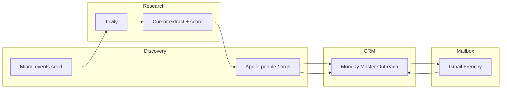

# The Underline automation

Python CRM and outreach engine for **The Underline** (Miami public-space park). Mirth Studio runs partnerships, sponsorship, and venue-rental prospecting against a dedicated Monday board, with Gmail sequences and reply triage.

This file is the **single source of truth** for how the system works today. Agent rules: [`AGENTS.md`](AGENTS.md). Env names: [`.env.example`](.env.example). Dated files under `data/` are run artifacts, not docs.

| Artifact | Role |
|----------|------|
| **This README** | Architecture, operator commands, board contract, safety |
| [`AGENTS.md`](AGENTS.md) | How agents may change the repo (HITL, dry-run, do-not-resurrect) |
| [`.env.example`](.env.example) | Env contract (names + defaults; no secrets) |
| [`data/README.md`](data/README.md) | Folder map for inputs / outputs / engine DB |

Do not add new markdown for a feature. Update this README (and `.env.example` if you add an env var). If README and code disagree, **code defaults win** — then fix this file.

**Last verified against the repo:** 2026-10-13.

---

## What this repo does

Prospecting runs in one local app (FastAPI + SQLite + React). Separate CLIs send first-touch / follow-up email and triage inbound replies.



| Path | Where | How it finds people | Monday Vertical |
|------|--------|---------------------|-----------------|
| Sponsor brands | Engine | Seed events → Tavily → Cursor extract, then org lookup, firmographics, Cursor score | category from research |
| Concert Series | Engine | Apollo people + org-keyword, firmographic QA, Tavily paid-spend evidence | `Concert Series` |
| Venue rental | Engine | Apollo event/wedding/planner titles, light QA | `Venue Rental` |

**ICP (sponsor brands):** shelf consumer brands with budget — Fiji, not AB InBev as the item name. Contacts who can buy sponsorship or brand marketing. Florida/Miami preferred; global HQ is OK when the person is in-market.

**ICP (concert series):** cash-sponsorship brands for the Miami Music Series (Levitt BLOC) — official / title / presenting spend, not community / collab / in-kind partners. Apollo proxies: **$10M** org revenue and **51+** employees; titles are paid-buyer only (Sponsorship, Brand Marketing, Experiential/Festival/Entertainment Marketing, CMO / VP / Head of Marketing). Default search is Florida only (location tier 3). Tier 4 is the US search; the Florida person gate still applies when that toggle is on. After enrich, a person outside Florida is not created, and Monday City/State is the person's location, not company HQ. Tavily spend evidence is required before a Monday create (batched: default **8 brands per search**, **3 searches in flight**, `fast` depth, disk-cached). Do not use Levitt re-engagement templates for Email 1.

**ICP (venue rental):** people who book events (planners, coordinators, agencies, nonprofits). Florida person by default; US fallback is a Gather toggle.

Shared rules: a company or corporate domain already on the board blocks a new contact; `data/inputs/blacklist.txt` is human-edited and read-only; federal / `.gov` / non-sponsor healthcare / agency / `.edu` gates live in [`src/prospecting_qa.py`](src/prospecting_qa.py); item name = shelf brand.

---

## Quickstart

Python **3.11+** (repo pin: **3.13**). Uses `uv` and a local `.venv`. From the repo root:

```powershell
uv sync --group dev
copy .env.example .env   # then fill secrets
.\.venv\Scripts\python -m pytest tests\ -q
```

Minimum keys for prospecting: `APOLLO_API_KEY`, `MONDAY_API_KEY`. Sponsor brands also need `TAVILY_API_KEY` and `CURSOR_API_KEY`. Gmail CLIs need OAuth files under `config/` (gitignored). Reply triage also needs `GEMINI_API_KEY`.

---

## Prospecting engine

The engine is the production prospecting path. FastAPI + SQLite (WAL), one in-process worker thread, React UI on the same origin. Code: `src/engine/` and `web/`. Gate predicates stay in `src/prospecting_qa.py`, `src/concert_series_qa.py`, and `src/venue_rental_qa.py` — the engine composes them, it does not reimplement them.

Three verticals: **Sponsor brands**, **Concert Series**, **Venue rental**. Concert and Venue search Apollo people for free, then spend only on survivors. Sponsor brands start from the event seed (Tavily, then Cursor), run free name gates before any org lookup, score with Cursor, and pause on the shortlist. Enrich runs only after you confirm, and only for leads you did not reject. Push asks once, then writes to Monday when `ENGINE_LIVE_PUSH_ENABLED=true`.

Park-adjacent and CSV import were removed.

### Run it

```powershell
uv sync --group dev
npm --prefix web install
npm --prefix web run build
uv run uvicorn engine.api:app --app-dir src --host 127.0.0.1 --port 8765
```

Open `http://127.0.0.1:8765/` (Gather). Preset is `/preset`. Run pages are `/runs/<id>`. The process binds to `127.0.0.1` only. Python changes need a process restart; a new `web` build does not.

| Task | Command |
|------|---------|
| UI dev server (hot reload, `/api` proxied to :8765) | `npm --prefix web run dev` |
| Regenerate UI types after an API or model change | `npm --prefix web run gen:api` |
| Typecheck the UI | `npm --prefix web run typecheck` |
| Engine tests | `uv run pytest tests\engine -q` |
| Lint the engine | `uv run ruff check src\engine tests\engine` |

### Screens

**Gather** (`/`): pick a vertical, set **this run's** limits and gates, optionally **Measure free probe** (Concert / Venue), then Start. A trash icon removes a finished run (cancel a live run first). Deleting a run does not refund credits.

**Preset** (`/preset`): search titles, seniorities, locations, org keywords, event seed path, Monday board id, New Leads group, and protected groups/statuses. Saving writes into the engine database (`preset_settings`, schema 3). That saved board id wins over `MASTER_BOARD_ID` / `NEW_LEADS_GROUP_ID` for prospecting runs. Email, triage, and cleanup still read those env vars. Column ids are filled from the live board by title on save. **Reset** restores code defaults in [`src/engine/presets/underline.py`](src/engine/presets/underline.py).

**Review** (`/runs/<id>`): shortlist → Enrich → approve → Push.

### How a run works

1. Refresh the Monday snapshot if it is stale (Start does this after `CRM_SNAPSHOT_TTL_HOURS`, default 12h; **Refresh board** does it now). Refresh is refused while a run is live.
2. Concert / Venue: **Measure free probe** runs free Apollo people search and replaces cap upper bounds. It spends 0 Apollo credits.
3. Start. Free gates and the blocklist run before paid calls.
4. Concert buys org lookup, firmographics, and Tavily spend evidence. Venue skips org lookup and Tavily. Sponsor brands spend Tavily and Cursor at the source, then free name gates, then Apollo org lookup, then Cursor score.
5. LLM QA: Gemini (Concert, Venue) or Cursor score (Sponsor brands). `fail` cannot be approved. A model error becomes `flag` with reason "LLM unavailable", never `pass`.
6. Status `awaiting_enrich`. Reject companies you do not want, then confirm **Enrich N**. Only shortlisted, non-rejected leads are enriched.
7. Post-enrich gates. Florida person is final when that toggle is on. Monday City / State / Country are the person's location. Item name is the shelf brand.
8. Approve is all-or-nothing. Push asks once, re-reads the board for emails added since the run started, checks the live column contract, creates New Leads items, stores each Monday item id so a later push does not duplicate the row, and DMs Lia with company names only. The write still needs `ENGINE_LIVE_PUSH_ENABLED=true`.

A call that would pass the run's reservation or the live balance stops the run (`budget_stopped`) and leaves the leads reviewable.

### Blocklist (deterministic, free)

A new contact is blocked when any of these holds:

- its email is already on the board, or it is a duplicate earlier in the same run
- its corporate email or website domain is on the board (personal inboxes such as `gmail.com` never block)
- its company or shelf brand matches a board row or a line in `data/inputs/blacklist.txt`
- its company is in an active conversation (Engaged / Replied, Meeting / Pipeline, Closed Won, or status Replied / Meeting Set / Proposal Sent)
- after enrich, its exact full name matches a board row

`data/inputs/blacklist.txt` is human-edited. No module rewrites it. Up to `max_per_company` contacts per company are allowed within one run.

### Credits and models

People search (`mixed_people/api_search`) costs **0**. Organization search is `POST /v1/organizations/search` and costs **1 credit per page**. People enrich (`people/match`) costs **1 credit per person**. A cached call within `API_CACHE_TTL_DAYS` (default 30) costs 0.

The estimate shows what this run would spend and what is left. Live Apollo and Tavily balances are cached for 15 minutes.

| Provider | What the estimate uses |
|----------|------------------------|
| Apollo | Remaining lead credits and cycle end from Apollo |
| Tavily | Remaining plan credits from Tavily (resets on the 1st) |
| Cursor | `CURSOR_MONTHLY_RUN_CEILING` minus runs this app logged since the 13th (no balance API) |
| Gemini | No remaining figure. A blank `GEMINI_MONTHLY_REQUEST_CEILING` does not block a run |

If Apollo or Tavily cannot be read, Start falls back to the matching `.env` ceiling and refuses the run when that ceiling is blank or too small.

**Models.** Concert / Venue QA: `GEMINI_QA_MODEL` (`gemini-3.8-flash`, structured JSON, thinking level low). Fallback: `GEMINI_QA_FALLBACK_MODEL` (`gemini-2.5-flash`). Reply triage stays on `gemini-2.5-flash-lite`. Cursor research stays on `composer-2.5`. That model's default variant is fast, so the engine refuses `CURSOR_COMPOSER_FAST=true` and any model id containing `fast`.

**Sponsor research.** Seed file: `data/inputs/miami_events_seed.json` (many events; a run uses the Gather caps, factory default **4 events / 8 brands / 2 queries per event**). Discover new events is off until you turn it on; it spends Tavily and one Cursor extract, then merges into the seed file. An optional Brief adds one extra Tavily query per event, inside `RUN_MAX_TAVILY_QUERIES` (default 25).

### Hosting and backups

The app binds to localhost. `Cf-Access-Authenticated-User-Email` stamps who started a run, decided a lead, or pushed. There is no user table. `CF_ACCESS_TEAM_DOMAIN` and `CF_ACCESS_AUD` stay blank until a named Cloudflare Access tunnel exists. A Cloudflare quick tunnel has **no allowlist** — anyone with the URL can spend credits.

`data/engine/` (SQLite, WAL, nightly copies) is gitignored. While the app runs it writes `data/engine/backups/underline-YYYY-MM-DD.db` and keeps 14 copies. Same copy by hand:

```powershell
.\.venv\Scripts\python scripts\engine_backup.py
```

Uvicorn is started by hand. It is not a startup task.

---

## Commands

All destructive or send paths default to **dry-run**. Pass `--live` or `--apply` only after reviewing output.

### Prospecting

Runs in the engine UI (`http://127.0.0.1:8765/`). Pick a vertical, set gates, start, reject at the shortlist, enrich, approve, then push.

Follow-up sends skip a contact when State is filled in and is not Florida (`--allow-out-of-state` turns that off). Monday State is the person's state, so a Florida person at a New York HQ brand is not skipped.

### First-touch and follow-ups (Gmail)

```powershell
.\.venv\Scripts\python scripts\send_concert_series_email1.py
.\.venv\Scripts\python scripts\send_concert_series_email1.py --live --max-sends 20

.\.venv\Scripts\python scripts\send_venue_rental_email1.py
.\.venv\Scripts\python scripts\send_venue_rental_email1.py --live --max-sends 20

# Emails 2–3 same thread as Email 1; 4–5 new thread
.\.venv\Scripts\python scripts\send_followups_sequence.py --stage email2
.\.venv\Scripts\python scripts\send_followups_sequence.py --stage email3 --live --max-sends 10
.\.venv\Scripts\python scripts\send_followups_sequence.py --stage email4 --live
```

Copy source of truth: [`data/underline templates.txt`](data/underline%20templates.txt). Concert Series Email 1 is Miguel’s Miami Music Series first-touch (no deck URL). Deck URL for Email 2+ / venue Email 1: `UNDERLINE_DECK_LINK`.

Default follow-up Last Contacted window: **2026-03-25 → 2026-06-01** (override with `--date-from` / `--date-to` or `FOLLOWUP_DATE_FROM` / `FOLLOWUP_DATE_TO`).

Live email batches and live Monday pushes DM Lia on Slack when tokens are set ([`src/slack_notify.py`](src/slack_notify.py)). Set `SLACK_NOTIFY=false` to mute. Commenting the line out does not mute.

### Reply triage

Inbound Gmail label `REPLIES` (Frenchy’s mailbox, not sent by us) → match sender to Monday → Gemini JSON → HITL under `data/outputs/` → optional `--apply`.

```powershell
.\.venv\Scripts\python scripts\triage_gmail_replies.py --month 2026-08 --max 10 --fetch-only
.\.venv\Scripts\python scripts\triage_gmail_replies.py --month 2026-08
.\.venv\Scripts\python scripts\triage_gmail_replies.py --month 2026-08 --apply
```

First Monday index load is slow; reuse `data/outputs/monday_triage_index_cache.json` unless you pass `--refresh-monday-cache`. Do not paste raw reply bodies into Monday Notes.

### Hygiene and Monday utilities

```powershell
.\.venv\Scripts\python src\inspect_new_leads.py
```

Active Outreach cleanup is a **library**, not a `scripts/` CLI: [`src/active_outreach_cleanup.py`](src/active_outreach_cleanup.py) audits the Active Outreach group, writes a HITL bundle under `data/outputs/`, and can apply deletes/moves only after that review. Concert Series is the Vertical column, not a board group. Do not delete Monday rows without a reviewed HITL CSV.

---

## Monday board

**Board:** The Underline \| Master Outreach (`MASTER_BOARD_ID`, default `18401545002`).

**API version:** GraphQL `API-Version` defaults to **`2026-07`**. Override with `MONDAY_API_VERSION`. Client: [`src/monday_client.py`](src/monday_client.py).

IDs below are **code defaults**. `config/board_monday_config.txt` is a historical GraphQL snapshot — refresh it from Monday if labels drift. Saving the Preset screen re-reads column ids from the live board by title. [`src/prospecting_config.py`](src/prospecting_config.py) `MONDAY_VERTICAL_LABELS` includes `Venue Rental` and `Concert Series`.

| Group | Env / default ID |
|-------|------------------|
| New Leads | `NEW_LEADS_GROUP_ID` = `group_mm0xbmrj` |
| Active Outreach | `ACTIVE_OUTREACH_GROUP_ID` = `group_mm0x18c` |
| Engaged / Replied | `TRIAGE_GROUP_ENGAGED` = `group_mm0xj5rd` |
| Meeting / Pipeline | `TRIAGE_GROUP_MEETING` = `group_mm0xj1qw` |
| Closed Won | `group_mm0xnfca` |
| Disqualified | `TRIAGE_GROUP_DISQUALIFIED` = `group_mm0xtvgg` |

| Column | ID | Used by |
|--------|-----|---------|
| Lead Status | `status` | engine, email, triage |
| Outreach Stage | `color_mm0x44cb` | email, triage |
| Vertical | `dropdown_mm0xx10b` | engine |
| Interest Level | `color_mm0xtvq2` | triage |
| Notes | `text_mm0xz0w2` | engine, triage |
| First Name | `text_mm0xjngp` | engine, email |
| Last Name | `text_mm0xg7qz` | engine |
| Title | `text_mm0xg2xb` | engine, triage |
| Email | `email_mm0xb00t` | engine, email, triage |
| Website | `text_mm0xt1wm` | engine |
| LinkedIn | `text_mm0xyyzh` | engine |
| Record Type | `dropdown_mm0x5x0q` | engine |
| Seniority | `text_mm0x49y` | engine |
| Departments | `text_mm0xcyag` | engine |
| Annual Revenue | `numeric_mm0x7xfb` | engine |
| City / State / Country | `text_mm0xkdyw` / `text_mm0xrszg` / `text_mm0x4tb7` | engine |
| Last Contacted | `date_mm0xerpc` | email, triage |
| Next Action | `date_mm0x7ga4` | email, triage |

Funnel: New Leads → Active Outreach → Engaged / Replied → Meeting / Pipeline → Closed Won / Disqualified.

Startup reads the live board (`get_board_metadata`) and refuses Start and live push if a required column, the New Leads group, or a label such as Uncontacted, Contact, or a Vertical label is missing.

---

## Layout

```
scripts/     Operator CLIs (email, triage, engine backup)
src/         Libraries + inspect_new_leads. Prospecting runs in src/engine.
src/engine/  FastAPI app, worker, lanes, push, SQLite store
web/         React UI (Gather, Preset, Review)
tests/       pytest
config/      Gmail OAuth (gitignored) + board snapshot
data/inputs  Seeds and blocklists
data/outputs Run artifacts (many gitignored)
data/engine  SQLite + backups (gitignored)
```

| Area | Modules |
|------|---------|
| Sponsor research | `sponsor_research`, `miami_events_discover`, `sponsor_tavily_context`, `sponsor_llm_extract`, `brand_fit_scorer`, `sponsor_employer_resolve` |
| Apollo / QA | `apollo_*` (people search helpers live on `apollo_client`), `prospecting_qa`, `prospecting_config`, `brand_targeting`, `prospect_scoring` |
| Engine | `engine.api`, `engine.pipeline`, `engine.apollo_lane`, `engine.research_lane`, `engine.push`, `engine.crm` |
| Concert Series | `concert_series_config`, `concert_series_qa`, `concert_series_spend` |
| Venue rental | `venue_rental_config`, `venue_rental_qa` |
| Email | `email_outreach`, `send_followups_email1` (library), `send_followups_sequence`, `slack_notify` |
| Reply triage | `gmail_replies`, `reply_triage_gemini`, `reply_triage_monday` |
| Monday | `monday_client`, `active_outreach_cleanup`, `inspect_new_leads` |
| Cursor | `cursor_cloud_client`, `cursor_model`, `cursor_sdk_compat` |
| Context | `underline_knowledge` (optional PDFs under `data/`) |

---

## Environment

Copy [`.env.example`](.env.example). Never commit `.env` or `config/gmail_*.json`.

| Concern | Keys |
|---------|------|
| Required APIs | `APOLLO_API_KEY`, `MONDAY_API_KEY` (`MONDAY_API_VERSION` default `2026-07`) |
| Research | `TAVILY_API_KEY`, `CURSOR_API_KEY` |
| Gmail | `GMAIL_CREDENTIALS_FILE`, `GMAIL_TOKEN_FILE` |
| Triage | `GEMINI_API_KEY`, `GMAIL_REPLIES_LABEL`, `GEMINI_TRIAGE_MODEL` |
| Engine | `ENGINE_DB_PATH`, `ENGINE_LIVE_PUSH_ENABLED` (default false), `CRM_SNAPSHOT_TTL_HOURS`, `API_CACHE_TTL_DAYS`, `RUN_MAX_TAVILY_QUERIES` |
| QA models | `GEMINI_QA_MODEL`, `GEMINI_QA_FALLBACK_MODEL`, `CURSOR_RESEARCH_MODEL` |
| Sends | `DRY_RUN` (default true), `MAX_SENDS`, `UNDERLINE_DECK_LINK` |
| Slack | `SLACK_USER_TOKEN` or `SLACK_BOT_TOKEN`, `SLACK_LIA_USER_ID` / `SLACK_LIA_EMAIL`; `SLACK_NOTIFY=false` to mute |

Gate values for a run are set on Gather. Factory defaults live on the preset in code. Concert spend evidence uses `CONCERT_SPEND_BATCH_SIZE` (default 8), `CONCERT_SPEND_CONCURRENCY` (default 3), and `CONCERT_SPEND_TAVILY_DEPTH` (default `fast`). A one-time import still reads `data/outputs/concert_spend_cache.json` if that file is present.

---

## Safety

- Email stays dry-run unless `--live`. Triage stays dry-run unless `--apply`.
- Engine push writes after one confirmation, and only when `ENGINE_LIVE_PUSH_ENABLED=true`.
- Live Monday writes and live Gmail sends are production. Cap sends with `--max-sends` / `--max`.
- Cleanup: review HITL CSV/JSON, then apply. Never delete Monday rows without that review.
- A company name or corporate email domain already on the board blocks a new contact. Personal inbox domains do not. Within one run, up to `max_per_company` contacts at a new company are still allowed.
- After a live push, Slack notifies Lia with company names only (no emails in that DM).

---

## Do not resurrect

These paths were deleted on purpose (low quality, or superseded by the engine):

- Vertical Apollo rotation, US brand catalog, Gemini target lists, parent/shelf seed JSON CLIs
- `funnel_report` / Monday funnel dashboard scripts
- Duplicate `scripts/send_followups_email1.py` CLI (`src/send_followups_email1.py` stays as a library)
- Prospecting CLIs and Monday writers replaced by the engine: `prospect_interactive`, `weekly_sponsor_research`, `weekly_adjacent_research`, `build_miami_events_seed`, `e2e_prospect_underline`, `concert_series_prospect`, `venue_rental_prospect`, `sponsorship_discovery`, `prospect_push`, `concert_series_push`, `venue_rental_push`, `venue_rental_search`, `enrich_new_leads_group`
- Park-adjacent vertical and its modules: `underline_adjacent_research`, `underline_adjacent_tavily`, `underline_adjacent_extract`, `underline_adjacent_scorer`
- Engine CSV import

---

## Stakeholders and product context

| Person | Role |
|--------|------|
| Miguel | CRM, automations, outreach execution |
| Lia | Strategy, copy bar, prospecting quality |
| Jake | Partnership positioning |
| Frenchy | Original high-volume sender; Gmail mailbox still used |

Programming: amenity sponsorship (playgrounds, gyms, plazas, micro-forests, the Wilds, Mariposa Gardens), Miami Music Series (Levitt grant + brand sponsors), dining / wellness / cultural activations. KPI: meetings from this CRM (target: at least one per week), pipeline visibility in Monday — reporting is Monday-native, not a local dashboard.

---

## Known gaps

- Active Outreach cleanup has no `scripts/` wrapper; the library in `src/active_outreach_cleanup.py` is tested but not an operator CLI.
- `data/inputs/underline_park_segments_seed.json` is leftover from park-adjacent and is unused.
- Cloudflare Access / named tunnel is not wired (`CF_ACCESS_*` blank). A quick tunnel has no email allowlist.
- Uvicorn is not a scheduled service.
- `config/board_monday_config.txt` can lag the live board (vertical labels, groups).
- Biweekly reporting export is not automated.
